<picture></picture>

<h2 align="center">Hi, I'm Ayman Al-Khatib</h2>

  <picture>
    <source media="(prefers-color-scheme: dark)" srcset="assets/typing-dark.svg">
    
  </picture>

  
  

## About me

I'm a backend engineer from Damascus, Syria, working mainly with **Java and Spring Boot**. I design and build REST APIs and the services behind them, with a focus on security, clean architecture and maintainable code. I graduated from Damascus University in Information Technology Engineering (Software Engineering).

- **Main stack:** Java, Spring Boot, Spring Security, JPA / Hibernate, PostgreSQL, Redis, Docker, Kubernetes
- **Also:** NestJS for APIs and Flutter for mobile apps
- **Currently:** building microservices with Spring Boot and learning ERP system design
- **Problem solving:** competed in the 2023 ICPC Damascus University Collegiate Programming Contest

  <picture>
    <source media="(prefers-color-scheme: dark)" srcset="assets/skills-dark.svg">
    
  </picture>

## Achievements

  <picture><source media="(prefers-color-scheme: dark)" srcset="assets/live/trophies-1-dark.svg"></picture>
  <picture><source media="(prefers-color-scheme: dark)" srcset="assets/live/trophies-2-dark.svg"></picture>

  <picture><source media="(prefers-color-scheme: dark)" srcset="assets/live/stats-dark.svg"></picture>
  <picture><source media="(prefers-color-scheme: dark)" srcset="assets/live/streak-dark.svg"></picture>

## Contribution activity

<picture>
  <source media="(prefers-color-scheme: dark)" srcset="assets/live/snake-dark.svg">
  
</picture>

## Featured repositories

  <a href="https://github.com/aymansalkhatib/shakwa-backend"><picture><source media="(prefers-color-scheme: dark)" srcset="assets/live/repo-shakwa-backend-dark.svg"></picture></a>
  <a href="https://github.com/aymansalkhatib/nestjs-starter"><picture><source media="(prefers-color-scheme: dark)" srcset="assets/live/repo-nestjs-starter-dark.svg"></picture></a>
  <a href="https://github.com/aymansalkhatib/albarakah-backend"><picture><source media="(prefers-color-scheme: dark)" srcset="assets/live/repo-albarakah-backend-dark.svg"></picture></a>
  <a href="https://github.com/aymansalkhatib/hybrid-search-engine"><picture><source media="(prefers-color-scheme: dark)" srcset="assets/live/repo-hybrid-search-engine-dark.svg"></picture></a>
  <a href="https://github.com/aymansalkhatib/school-dashboard"><picture><source media="(prefers-color-scheme: dark)" srcset="assets/live/repo-school-dashboard-dark.svg"></picture></a>
  <a href="https://github.com/aymansalkhatib/bio-medika-mobile"><picture><source media="(prefers-color-scheme: dark)" srcset="assets/live/repo-bio-medika-mobile-dark.svg"></picture></a>

