<picture>
  <source media="(max-width: 900px)" srcset="assets/hero-mobile.svg">
  <source media="(prefers-color-scheme: dark)" srcset="assets/hero-dark.svg">
  
</picture>

  <a href="https://www.linkedin.com/in/aymansalkhatib"><picture><source media="(prefers-color-scheme: dark)" srcset="assets/btn-linkedin-dark.svg"></picture></a>
  <a href="mailto:aymansalkhatib@gmail.com"><picture><source media="(prefers-color-scheme: dark)" srcset="assets/btn-email-dark.svg"></picture></a>

I'm a software engineer focused on backend architecture: APIs and services that stay fast, secure and easy to change as they grow. I build them mostly with **NestJS** and **Spring Boot** on PostgreSQL and Redis, and I ship **Flutter** apps end to end, so I see a product from the database to the screen.

I graduated in Information Technology Engineering (Software Engineering) from Damascus University. I also help teams build ERP systems and move from a monolith to microservices.

## What I do

  <picture><source media="(prefers-color-scheme: dark)" srcset="assets/stack-backend-dark.svg">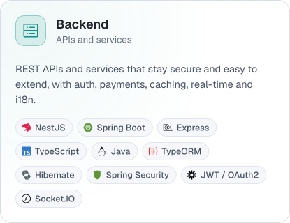</picture>
  <picture><source media="(prefers-color-scheme: dark)" srcset="assets/stack-mobile-dark.svg">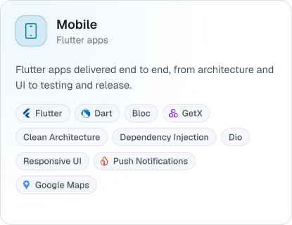</picture>
  <picture><source media="(prefers-color-scheme: dark)" srcset="assets/stack-data-dark.svg">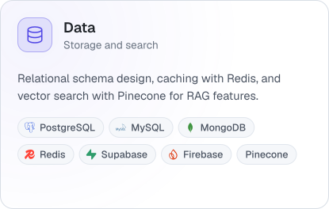</picture>
  <picture><source media="(prefers-color-scheme: dark)" srcset="assets/stack-devops-dark.svg">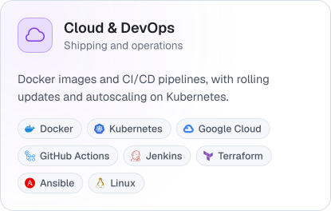</picture>

## Experience

  <picture><source media="(prefers-color-scheme: dark)" srcset="assets/exp-blendlab-dark.svg">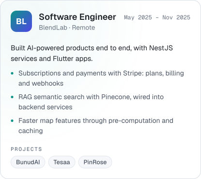</picture>
  <picture><source media="(prefers-color-scheme: dark)" srcset="assets/exp-bayan-dark.svg">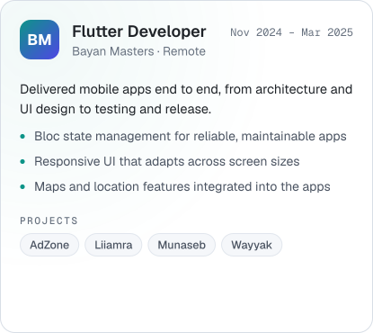</picture>

## Selected projects

  <a href="https://github.com/aymansalkhatib/shakwa-backend"><picture><source media="(prefers-color-scheme: dark)" srcset="assets/proj-shakwa-dark.svg">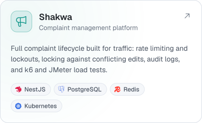</picture></a>
  <a href="https://github.com/aymansalkhatib/nestjs-starter"><picture><source media="(prefers-color-scheme: dark)" srcset="assets/proj-nestjs-starter-dark.svg">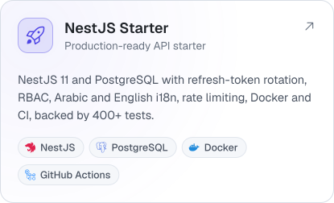</picture></a>
  <a href="https://github.com/aymansalkhatib/hybrid-search-engine"><picture><source media="(prefers-color-scheme: dark)" srcset="assets/proj-hybrid-search-dark.svg">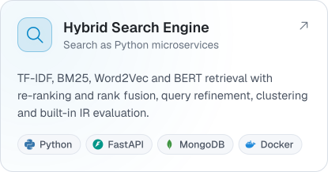</picture></a>
  <a href="https://github.com/aymansalkhatib/albarakah-backend"><picture><source media="(prefers-color-scheme: dark)" srcset="assets/proj-albarakah-dark.svg">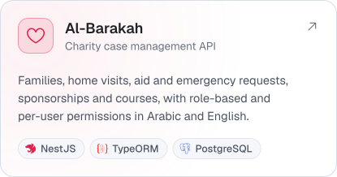</picture></a>
  <a href="https://github.com/aymansalkhatib/lexora-mobile"><picture><source media="(prefers-color-scheme: dark)" srcset="assets/proj-lexora-dark.svg">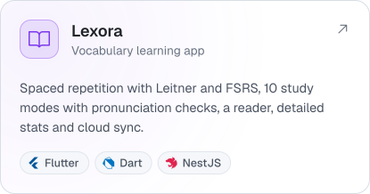</picture></a>
  <a href="https://github.com/aymansalkhatib/bio-medika-mobile"><picture><source media="(prefers-color-scheme: dark)" srcset="assets/proj-bio-medika-dark.svg">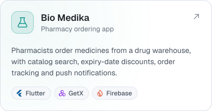</picture></a>

More on GitHub: <a href="https://github.com/aymansalkhatib/school-dashboard">school-dashboard</a> · <a href="https://github.com/aymansalkhatib/flutter-starter">flutter-starter</a> · <a href="https://github.com/aymansalkhatib/flutter-screenshot-protection">flutter-screenshot-protection</a> · <a href="https://github.com/aymansalkhatib/ghasaq">ghasaq</a> · <a href="https://github.com/aymansalkhatib/ecommerce-backend">ecommerce-backend</a>

## Education

  <picture><source media="(prefers-color-scheme: dark)" srcset="assets/edu-damascus-dark.svg">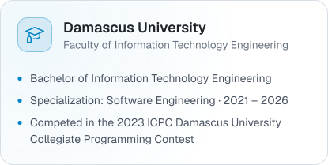</picture>
  <picture><source media="(prefers-color-scheme: dark)" srcset="assets/edu-certificates-dark.svg">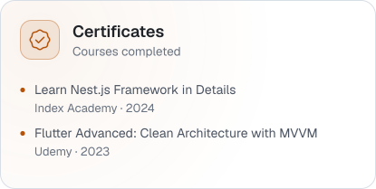</picture>

